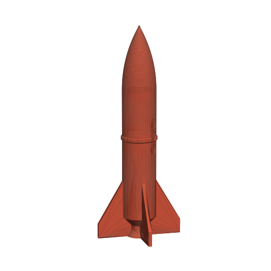

# 3D-printable rocket



A display rocket model you can print without supports. It is 150 mm tall, 24 mm across the body and 44 mm across the fins. It has an ogive nose cone, a decorative band, three recessed portholes, four swept fins and a nozzle bell.

## Files
- `rocket.stl`: ready to slice. The mesh is a single watertight piece.
- `make_rocket.py`: the parametric generator. Change the dimensions at the top of the file, or use the flags:
  ```
  pip install trimesh manifold3d scipy shapely
  python3 make_rocket.py --scale 1.5 --fins 3 --out rocket_big.stl
  ```

## Print settings
- **Orientation:** print it standing upright, as exported. The nozzle and the fin bottoms sit flat on the bed.
- **Supports:** none. Every overhang is 45° or less.
- **Layer height:** 0.12–0.2 mm. A smaller height gives a smoother nose cone.
- **Infill:** 10–15%, with 3 walls so the fins are fully solid.
- **Adhesion:** a brim of about 5 mm helps keep the fin tips flat.
- Print time is about 3–4 h at 0.2 mm, and it uses about 60 cm³ if printed solid (much less with infill).

This is a decorative model. It is not meant to hold a model-rocket motor.
